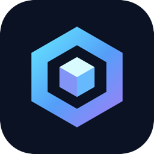

# OmniCore Discord Bot



OmniCore is an open-source Discord bot written in Rust. It combines server tools, AI chat, automatic moderation, image understanding, local image generation, and an opt-in voice assistant. This repository contains the bot and the project's public informational website. No model weights, credentials, database contents, or private messages are bundled.

## Features

- Slash and prefix commands for server information, roles, channel locks, moderation, and data deletion.
- Automatic moderation with warnings, configurable temporary timeouts, owner notices, and metadata-only analytics. [Policy and permissions](docs/AUTOMOD.md).
- Local Ollama chat and vision in bot-operator-approved guilds; server-owned OpenAI, Anthropic, or Gemini connections through a secure HTTPS `/ai setup` portal. Guild owners control models, limits, channels, roles, vision, and thinking. [Provider setup](docs/byok-operations.md).
- Image questions can use attachments on the invoking message or its exact direct reply target. The bot does not search prior channel history for images. [Vision rules](docs/VISION.md).
- Local `/imagegen` and `/imagine` generation with a compatible FLUX.2 Klein Ollama service. [Image generation requirements](docs/IMAGEGEN.md).
- Opt-in voice sessions with local Whisper recognition and Piper speech, text transcripts and replies in the command channel, a two-minute idle disconnect, and a private bot-operator kill switch. Voice is limited to explicitly preapproved or operator-approved guilds.

## Technology

Rust, Tokio, Poise/Serenity, MongoDB, Axum for the optional pairing portal, and Ollama or server-owned AI providers. The bot remains a single Rust application.

## Requirements

- Rust stable with edition 2024 support (the Dockerfile uses Rust 1.98.1), Cargo, C/C++ build tools, CMake, Clang/libclang, and OpenSSL development libraries. On macOS, Xcode Command Line Tools and Homebrew CMake/LLVM may be needed; on Debian/Ubuntu use the package list in the Dockerfile.
- Your own Discord application and bot token, with **Message Content** and **Server Members** privileged intents enabled in the Developer Portal. The code also requests Guilds, Guild Messages, Direct Messages, and Guild Voice States.
- MongoDB reachable privately by the bot. The bot creates needed collections and indexes at startup.
- Optional: Ollama for local AI; provider keys for cloud AI; separate local image service; Whisper/Piper model files for voice.

Grant the bot View Channels, Send Messages, Read Message History, Embed Links, Attach Files, and Use Application Commands where it will operate. Moderation needs Manage Messages and Moderate Members; timeout targets must be below the bot's highest role. Voice additionally needs Connect and Speak. Grant only the permissions for features you intend to use.

## Quick start

1. Create an application at the [Discord Developer Portal](https://discord.com/developers/applications). Add a bot, enable Message Content and Server Members intents, and copy its token into a **private** local file. Copy your own numeric Discord user ID with Developer Mode.
2. Clone, configure, and build:

   ```sh
   git clone https://github.com/Shreshtgaming606/OmniCore-Discord-Bot.git
   cd OmniCore-Discord-Bot
   cp .env.example .env
   # Edit .env: set DISCORD_TOKEN, MONGO_URI, and OMNICORE_OWNER_IDS.
   cargo build --release --locked
   cargo run --release --locked
   ```

3. Invite **your own** bot from Developer Portal → OAuth2 → URL Generator using `bot` and `applications.commands` scopes and only the needed permissions. Links on the included website point to the official hosted OmniCore instance, not your new application.
4. Start MongoDB before starting the bot. The [Compose example](compose.example.yml) supplies one. The bot registers general slash commands globally and operational commands per guild at startup; global changes may take time to appear in Discord.
5. Use `/help`, `/automod status`, and `/ai status` in a test server. Run `/approve` as a configured bot operator to enable local AI in that guild, or configure cloud AI as its server owner.

`.env.example` lists required and optional variables. The legacy `OMNICORE_OWNER_1_ID` and `OMNICORE_OWNER_2_ID` pair remains supported for existing installations; new hosts should use `OMNICORE_OWNER_IDS`. `BOT_OWNERS` defaults to that list. `OMNICORE_VOICE_BUILTIN_GUILDS` defaults to empty. Sharding defaults to one shard. Never commit `.env` or a copy of it.

### MongoDB and retention

`MONGO_URI` is required even if you use only cloud AI. The current code stores bot collections in the `omnicore_bot` database. Keep MongoDB off the public internet, enable authentication and backups for production, and configure host log retention. AI turns have a 30-day TTL; usage and moderation metadata have their own expiry. See [retention and migration](docs/RETENTION.md). Do not run the legacy migration's apply mode without a reviewed backup and matching dry-run counts.

### Local AI and AutoMod

Set `OLLAMA_BASE_URL` to your Ollama HTTP origin (no trailing slash) and `OLLAMA_MODEL` to an installed model name. If `OLLAMA_MODEL` is blank, startup skips the local client. Local chat, local vision, and AI-based AutoMod classification then cannot run; cloud `/ask` remains available if separately configured. For Docker Desktop on macOS, the host is commonly `http://host.docker.internal:11434`; direct local runs usually use `http://127.0.0.1:11434`. AutoMod defaults on; review its settings and test in a controlled guild before relying on timeouts.

### Cloud AI and secure owner portal

Cloud AI uses each server owner's provider account and may incur charges. To activate `/ai setup`, generate a stable master key with `openssl rand -hex 32`; set `OMNICORE_BYOK_MASTER_KEY_HEX`, your Discord application's `OMNICORE_DISCORD_CLIENT_ID` and `OMNICORE_DISCORD_CLIENT_SECRET`, and `OMNICORE_PUBLIC_BASE_URL` to **your own HTTPS origin**. In the Developer Portal, register the exact redirect `https://YOUR_DOMAIN/connect/callback`. Reverse proxy `/connect/` to the bot's port 8098 over a private network; serve it only over HTTPS. The portal is disabled if its configuration is absent or invalid. Losing the master key makes stored provider credentials unreadable. [Detailed pairing and security notes](docs/byok-operations.md).

### Image recognition and generation

Mention the bot with an attached image, or directly reply to the exact message containing the image. In DMs, an explicit image question can work only under the owner opt-in and billing rules described in [vision documentation](docs/VISION.md). The selected local or cloud model must support vision. Image bytes stay in short-lived memory and are not placed into conversation history or MongoDB.

`/imagegen` and `/imagine` use a separate local Ollama image service when `OMNICORE_IMAGEGEN_OLLAMA_URL` is set. They require a compatible server and `x/flux2-klein:4b`; a general text Ollama installation is insufficient. The bot does not download this model or start the service. `/imagegenstop` cancels active work and asks the model service to unload. See [setup and limits](docs/IMAGEGEN.md).

### Optional voice

Place licensed `ggml-base.en.bin` Whisper and Piper `vits-piper-en_US-lessac-medium/` model assets in `OMNICORE_VOICE_MODEL_DIR` (default `voice-models` relative to the process working directory). Model weights are not redistributed here. Configure a guild with `/voice settings`, then use `/voicejoin` in a text channel while in a voice channel. Each participant opts in with `/voice consent enabled:true`. Recognized speech and the bot's answer appear in that text channel; no wake phrase is needed. Sessions disconnect after roughly two minutes without use and unload local voice resources. `/voiceleave` disconnects immediately; `/voiceadmin kill` in the bot's DMs is restricted to configured operators. Configure `OMNICORE_VOICE_BUILTIN_GUILDS` privately or approve additional guilds through the operator controls.

### Docker Compose

`compose.example.yml` runs the bot and MongoDB without publishing MongoDB. Copy it to `compose.yml`, create a private `.env`, then run `docker compose up --build -d`. The example overrides `MONGO_URI` with the Compose service address. For host Ollama, uncomment the relevant host mapping and set `OLLAMA_BASE_URL` appropriately. For voice, mount your model directory read-only. For cloud owner pairing, add a private reverse proxy to port 8098; do not expose that HTTP port directly to the internet. The release workflow publishes images only when a GitHub release is published; pull requests never deploy.

## Development and troubleshooting

Run `cargo fmt --all -- --check`, `cargo clippy --all-targets --locked`, `cargo test --locked`, and `cargo build --release --locked`. Tests do not require production credentials or live Discord access. If the bot does not start, check required variables and MongoDB reachability. If a slash command is missing, verify invite scopes and wait for global registration; approved voice commands are guild-scoped. If local AI fails, verify the Ollama URL, model tag, and guild approval. If cloud setup is missing, verify the HTTPS origin, exact OAuth redirect, client credentials, and stable master key. Check logs without posting tokens or private message contents.

Report bugs through [GitHub Issues](https://github.com/Shreshtgaming606/OmniCore-Discord-Bot/issues) after removing private data. See [CONTRIBUTING.md](CONTRIBUTING.md) and [SECURITY.md](SECURITY.md) for code review and private vulnerability reports.

## License and credits

OmniCore's Rust source and original project assets are distributed under [GNU GPL version 3](LICENSE), identified in Cargo metadata as `GPL-3.0-only`. You may use, modify, and redistribute them under that license; distributions must meet its notice, source, and copyleft requirements. Third-party crates and the included Manrope font have their own licenses; see [third-party notices](THIRD_PARTY_NOTICES.md). Separately obtained model weights retain their own licenses. This repository includes no provider API keys or model weights.

Created by **Shresht Hiremath** and **Arnay Kumar**, with contributions reflected in the Git history, including **L1FE**. AI tools assisted with portions of the implementation and documentation; human review remains required.
